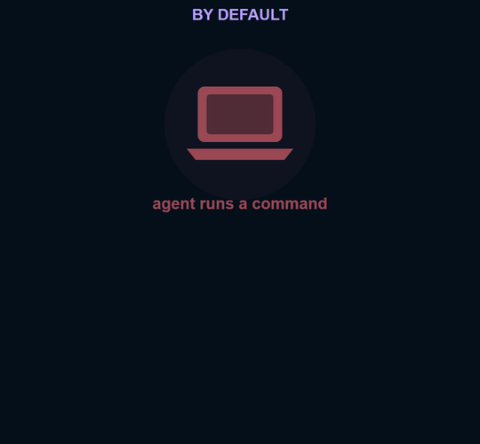
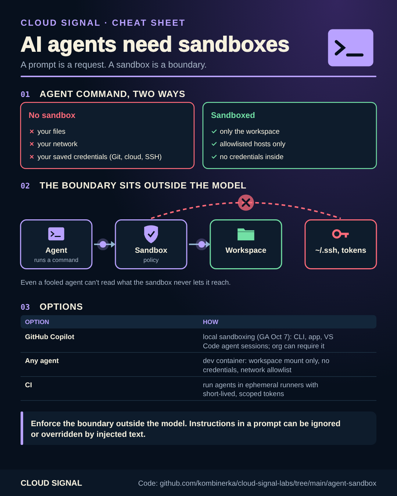

# AI agents need sandboxes

Companion code for the Cloud Signal Short **"Your AI Agent Has Terminal Access. Does It Have Your Whole Computer?"**





A command an AI agent runs has your rights: your files, your network, your saved credentials. "Please don't touch
the secrets folder" in a prompt is a request, not a boundary. The boundary has to be enforced **outside** the model.

| Option | What it limits | How |
|---|---|---|
| GitHub Copilot local sandboxing (GA, Oct 7 2026) | files, network, Git and GitHub CLI credentials for commands the agent starts; organizations can require it | Copilot CLI, Copilot app, VS Code sessions using Agent Host |
| Any agent, container | only this folder, no credentials, no network by default | [`run-sandboxed.sh`](run-sandboxed.sh) |
| Any agent, VS Code | the agent's terminal runs in a dev container | [`.devcontainer/devcontainer.json`](.devcontainer/devcontainer.json) |
| CI | ephemeral runners, short-lived tokens scoped to the job | see [oidc-deploy](../oidc-deploy/) |

```bash
./run-sandboxed.sh node:22-bookworm bash          # look around: no ~/.ssh, no ~/.azure, no network
NETWORK=bridge ./run-sandboxed.sh node:22-bookworm npm test
```

Notes:

- `--network none` is the safe default; if the agent needs the internet, route it through a proxy that only allows
  the registries and APIs the task needs.
- VS Code can forward your Git credentials and SSH agent into dev containers. Check your Dev Containers settings if
  you want the container to have none.
- A sandbox limits damage; it doesn't make the agent's output trustworthy. Review its changes like any pull request.

## Sources

- GitHub Changelog: Local sandboxing for GitHub Copilot now generally available: https://github.blog/changelog/2026-10-07-local-sandboxing-for-github-copilot-now-generally-available/
- Docker: docker run reference (security options, capabilities): https://docs.docker.com/reference/cli/docker/container/run/
