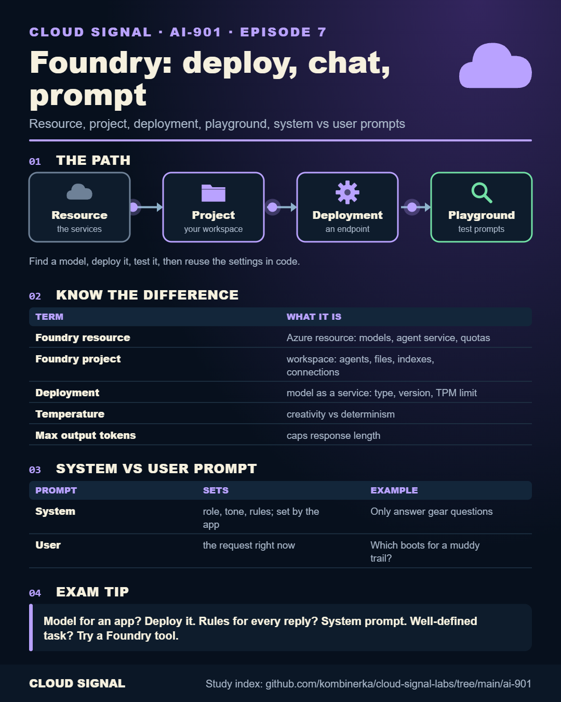

# AI-901 study index

Companion page for the free **AI-901 Microsoft Azure AI Fundamentals** course on Cloud Signal (YouTube): one cheat
sheet per episode for revision or printing, plus the Python code from the hands-on episodes (8–12).
Skills measured as of 15 April 2026. Check Microsoft's
[AI-901 study guide](https://learn.microsoft.com/credentials/certifications/resources/study-guides/ai-901) for the current outline.

Animated versions (where an episode has a flow) loop in the browser; the static PNG next to it is the one to print.

## Part 1: AI concepts and capabilities

| # | Video | Cheat sheet |
|---|---|---|
| 1 | AI-901 Explained: The 6 AI Workloads You Must Recognize | [static](e01-cheatsheet.png) |
| 2 | Responsible AI: Microsoft's 6 Principles Explained | [static](e02-cheatsheet.png) · [animated](e02-cheatsheet-animated.png) |
| 3 | How Generative AI Works: Tokens, Embeddings and Hallucinations | [static](e03-cheatsheet.png) · [animated](e03-cheatsheet-animated.png) |
| 4 | Choose, Deploy and Tune an AI Model: Temperature, Top-P, Max Tokens | [static](e04-cheatsheet.png) |
| 5 | Text Analysis and Speech AI Explained: Keywords, Entities, Sentiment, Speech | [static](e05-cheatsheet.png) · [animated](e05-cheatsheet-animated.png) |
| 6 | Computer Vision, Image Generation and Information Extraction Explained | [static](e06-cheatsheet.png) · [animated](e06-cheatsheet-animated.png) |

## Part 2: Building with Microsoft Foundry

| # | Video | Cheat sheet | Code |
|---|---|---|---|
| 7 | Microsoft Foundry Tour: Deploy a Model, Playground, System vs User Prompts | [static](e07-cheatsheet.png) · [animated](e07-cheatsheet-animated.png) | (portal only) |
| 8 | Build a Python Chat App with the Microsoft Foundry SDK | [static](e08-cheatsheet.png) · [animated](e08-cheatsheet-animated.png) | [e08-chat-app](e08-chat-app/) |
| 9 | Build an AI Agent in Microsoft Foundry and Call It From Python | [static](e09-cheatsheet.png) | [e09-agent](e09-agent/) |
| 10 | Text Analysis and Speech Apps With Azure Language, Azure Speech and Voice Live | [static](e10-cheatsheet.png) | [e10-text-and-speech](e10-text-and-speech/) |
| 11 | Vision and Image Generation in Microsoft Foundry: Multimodal Prompts, GPT-Image and Sora | [static](e11-cheatsheet.png) | [e11-vision-and-images](e11-vision-and-images/) |
| 12 | Azure Content Understanding Explained: Extract Data from Documents, Audio and Video | [static](e12-cheatsheet.png) · [animated](e12-cheatsheet-animated.png) | [e12-content-understanding](e12-content-understanding/) |

## Practice sets

Original questions written against the skills outline (not exam dumps). The sheets summarise the topics and the
distinctions that decide the answers, not the questions themselves.

| Set | Video | Cheat sheet |
|---|---|---|
| P1 | AI-901 Practice Questions: AI Concepts and Capabilities (15 Questions) | [static](p1-cheatsheet.png) |
| P2 | AI-901 Practice Questions: Building with Microsoft Foundry (15 Questions) | [static](p2-cheatsheet.png) |

## The code

Each script follows the Microsoft Learn module or exercise named at its top, with the Pinecone examples from the
videos. Every file says which packages to install and which environment variables to set. The variable names
differ between episodes because they follow each Learn module; set them per folder.

- **Validated, not deployed:** every script compiles and was checked against the current SDK docs, but none was run
  against a live Foundry resource for this repo. Expect to adjust endpoints and deployment names to your own.
- **Never hard-code keys or endpoints.** Use environment variables or a `.env` file that you keep out of git.
- Projects (`AIProjectClient`) need a Microsoft Entra ID sign-in (for example `az login`); key-based authentication
  is not supported for projects. Model, Language, Speech and Content Understanding calls in these examples use a key.
- Running the examples creates billable resources in your Azure subscription. Delete the resource group when done.

## Preview

