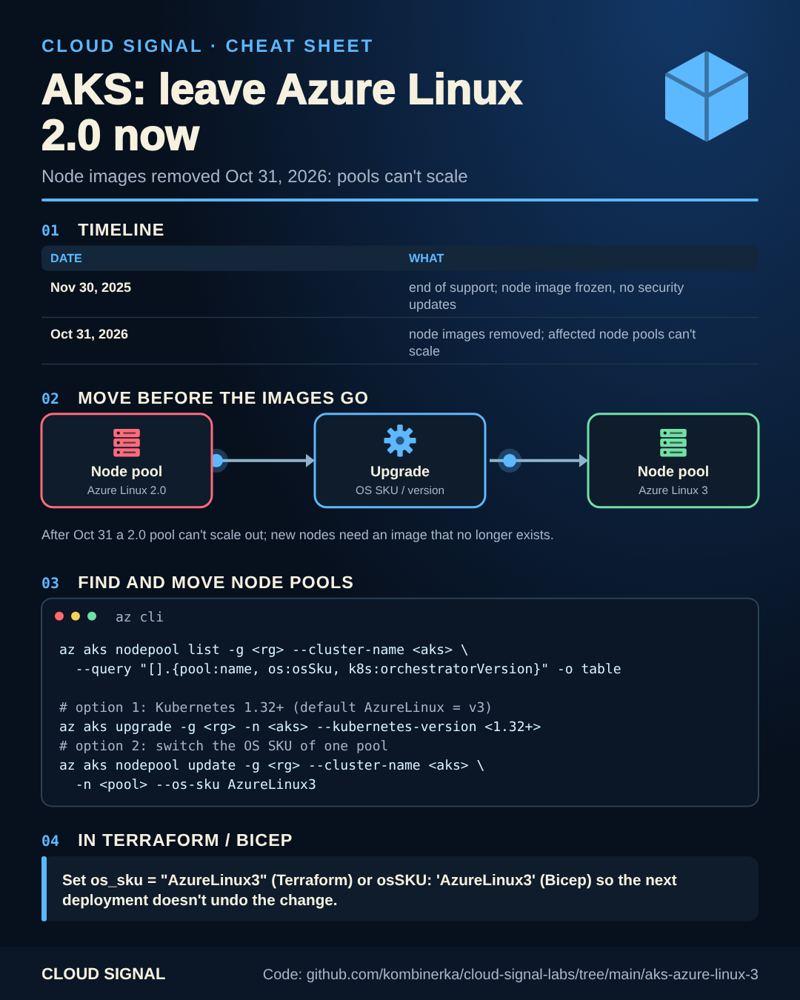

# AKS: move off Azure Linux 2.0 before October 31

▶ **[Watch the video](https://www.youtube.com/watch?v=qnMGXbeo_l8)**

Companion code for the Cloud Signal Short **"Your AKS Node Pool Might Stop Scaling on October 31"**

Static version for printing or sharing: [cheatsheet.png](cheatsheet.png)

Azure Linux 2.0 reached end of support on AKS on November 30, 2025; its node image has been frozen since. On
October 31, 2026 the node images are removed and node pools that still use them **can't scale**.

| Step | How |
|---|---|
| Find affected pools | [`find-and-migrate.sh`](find-and-migrate.sh) (all clusters you can read) |
| Option 1 | upgrade to Kubernetes 1.32+: default `AzureLinux` node pools use Azure Linux 3 there |
| Option 2 | switch one pool's OS SKU: `RG=… CLUSTER=… POOL=… ./find-and-migrate.sh --migrate` (`--os-sku AzureLinux3`) |
| Update your code | Terraform [`os_sku = "AzureLinux3"`](terraform/main.tf) · Bicep [`osSKU: 'AzureLinux3'`](bicep/main.bicep) |

Changing the OS SKU reimages the nodes: do one node pool first, during a quiet hour, with PodDisruptionBudgets in
place. The update can fail if there's no Azure Linux 3 image for your Kubernetes version, VM size or FIPS setting.

## Sources

- Microsoft Learn: Upgrade the OS version in AKS clusters: https://learn.microsoft.com/en-us/azure/aks/upgrade-os-version
- Microsoft Learn: Enable Azure Linux 3.0 on AKS: https://learn.microsoft.com/en-us/azure/azure-linux/how-to-enable-azure-linux-3
