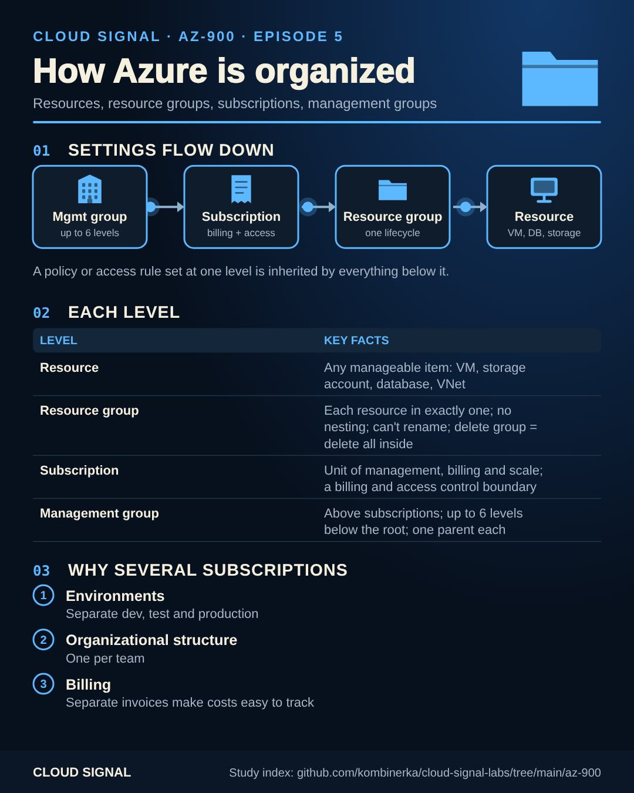

# AZ-900 study index

▶ **[Watch the full course playlist on YouTube](https://www.youtube.com/playlist?list=PLR_ZNJkcEcY4)**

Companion page for the free **AZ-900 Azure Fundamentals** course on Cloud Signal (YouTube): one cheat sheet per episode,
for revision or printing. Skills measured as of 20 July 2026 — check Microsoft's
[AZ-900 study guide](https://learn.microsoft.com/credentials/certifications/resources/study-guides/az-900) for the current outline.

Animated versions (where an episode has a flow, e.g. how settings inherit or how a Data Box travels) loop in the browser;
the static PNG next to it is the one to print.

## Course

| # | Exam area | Video | Cheat sheet |
|---|---|---|---|
| 1 | Cloud concepts | [What Is Cloud Computing? CapEx vs OpEx, Pricing Models and Serverless – AZ-900](https://www.youtube.com/watch?v=Iojmid4lry4) | [static](e01-cheatsheet.png) |
| 2 | Cloud concepts | [Shared Responsibility in Azure: IaaS vs PaaS vs SaaS Explained (AZ-900)](https://www.youtube.com/watch?v=Fe65Fb0heLE) | [static](e02-cheatsheet.png) |
| 3 | Cloud concepts | [Public vs Private vs Hybrid Cloud, and Why the Cloud Is Reliable – AZ-900](https://www.youtube.com/watch?v=Sjltfpw5Qzk) | [static](e03-cheatsheet.png) |
| 4 | [Architecture and services](https://www.youtube.com/watch?v=YWzjf0WqAFs) | Azure Regions, Availability Zones and Datacenters Explained (AZ-900) | [static](e04-cheatsheet.png) |
| 5 | [Architecture and services](https://www.youtube.com/watch?v=ubuDk7UlHCg) | Azure Resource Groups, Subscriptions and Management Groups Explained (AZ-900) | [static](e05-cheatsheet.png) · [animated](e05-cheatsheet-animated.png) |
| 6 | [Architecture and services](https://www.youtube.com/watch?v=uV8xk68toAU) | Azure Compute Explained: VMs vs Containers vs Functions vs App Service – AZ-900 | [static](e06-cheatsheet.png) |
| 7 | [Architecture and services](https://www.youtube.com/watch?v=uoyEzjzaFe8) | Azure Networking Explained: Virtual Networks, Subnets, VPN Gateway and ExpressRoute (AZ-900) | [static](e07-cheatsheet.png) · [animated](e07-cheatsheet-animated.png) |
| 8 | [Architecture and services](https://www.youtube.com/watch?v=QgDrN1CtaCc) | Azure Storage Explained: Blob, Files, Queues, Tables, Access Tiers and Redundancy (AZ-900) | [static](e08-cheatsheet.png) · [animated](e08-cheatsheet-animated.png) |
| 9 | [Architecture and services](https://www.youtube.com/watch?v=iy4S0fBlhQA) | AzCopy, Storage Explorer, File Sync, Azure Migrate and Data Box Explained (AZ-900) | [static](e09-cheatsheet.png) · [animated](e09-cheatsheet-animated.png) |
| 10 | [Architecture and services](https://www.youtube.com/watch?v=xF1JWYkHFbo) | Microsoft Entra ID Explained: SSO, MFA, Passwordless and Conditional Access (AZ-900) | [static](e10-cheatsheet.png) · [animated](e10-cheatsheet-animated.png) |
| 11 | [Architecture and services](https://www.youtube.com/watch?v=caElESpXL_0) | Azure Security Explained: RBAC, Zero Trust, Defense in Depth and Defender for Cloud (AZ-900) | [static](e11-cheatsheet.png) |
| 12 | [Management and governance](https://www.youtube.com/watch?v=BEhu2khMdOo) | What Drives Your Azure Bill? Cost Factors, Pricing Calculator, Cost Management and Tags (AZ-900) | [static](e12-cheatsheet.png) |
| 13 | [Management and governance](https://www.youtube.com/watch?v=_YhoNHFlW6M) | Azure Governance Explained: Microsoft Purview, Azure Policy and Resource Locks (AZ-900) | [static](e13-cheatsheet.png) |
| 14 | [Management and governance](https://www.youtube.com/watch?v=LadI7Z3w3-0) | Azure Portal vs Cloud Shell vs CLI vs PowerShell, Plus ARM Templates, Bicep and Azure Arc (AZ-900) | [static](e14-cheatsheet.png) · [animated](e14-cheatsheet-animated.png) |
| 15 | [Management and governance](https://www.youtube.com/watch?v=DA6xoayL1Uw) | Azure Monitoring Explained: Advisor vs Service Health vs Azure Monitor (AZ-900) | [static](e15-cheatsheet.png) · [animated](e15-cheatsheet-animated.png) |

## Practice sets

Original questions written against the skills outline (not exam dumps). The sheets summarise the topics and the
distinctions that decide the answers, not the questions themselves.

| Set | Video | Cheat sheet |
|---|---|---|
| P1 | [AZ-900 Practice Questions: Cloud Concepts (15 Questions) – AZ-900 #16](https://www.youtube.com/watch?v=06SbsvvfQpo) | [static](p1-cheatsheet.png) |
| P2 | [AZ-900 Practice Questions: Azure Architecture and Services (15 Questions) – AZ-900 #17](https://www.youtube.com/watch?v=ii3G45iFNlU) | [static](p2-cheatsheet.png) |
| P3 | [AZ-900 Practice Questions: Azure Management and Governance (15 Questions) – AZ-900 #18](https://www.youtube.com/watch?v=zA5iRBqx71Y) | [static](p3-cheatsheet.png) |
| P4 | [AZ-900 Flash Notes: Every Exam Objective in 9 Minutes – AZ-900 #19](https://www.youtube.com/watch?v=RLEYhbkBxAY) | [static](p4-cheatsheet.png) |

## Preview

