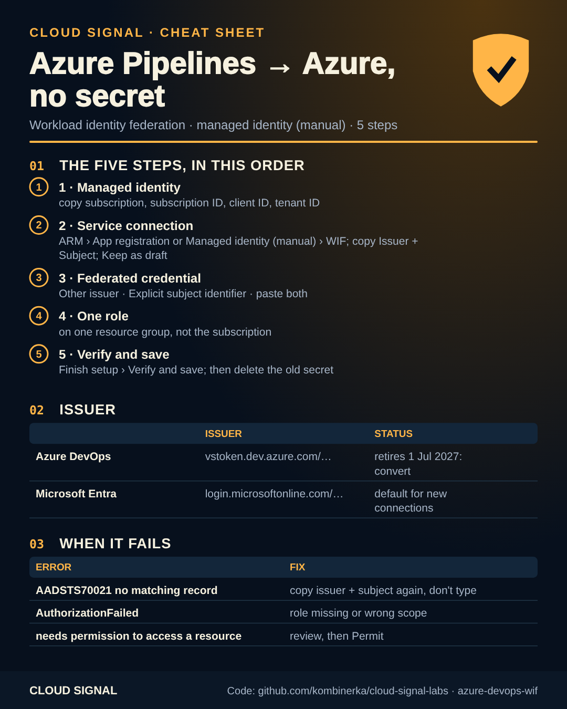

# Azure Pipelines → Azure without a secret (workload identity federation, managed identity)

Companion code for the Cloud Signal video **"Azure Pipelines Workload Identity Federation Step by Step"**.

An Azure Resource Manager service connection that uses **workload identity federation** stores no secret. When a job
uses the connection, Azure DevOps gets a short-lived signed token that names this service connection; Microsoft
Entra ID compares it with a federated credential on the identity (issuer, subject and audience must match exactly)
and returns an access token.

## The issuer changed

| | Issuer | Subject | Status |
|---|---|---|---|
| Azure DevOps issuer | `https://vstoken.dev.azure.com/<organization id>` | `sc://<organization>/<project>/<service connection>` | deprecated, retires **1 July 2027**: convert flagged connections |
| Microsoft Entra issuer | `https://login.microsoftonline.com/<tenant id>/v2.0` | `<Entra prefix>/sc/<organization id>/<service connection id>` | default for new connections |

Never type issuer or subject: copy them from the service connection.

## The five steps (manual option, user-assigned managed identity), in this order

1. **Create the managed identity.** Copy Subscription, Subscription ID, Client ID and (Settings › Properties) Tenant Id.
   Or run the template once without issuer/subject.
2. **Create the service connection, keep it as a draft.** Project settings › Service connections › New service
   connection › Azure Resource Manager › identity type *App registration or Managed identity (manual)* › credential
   *Workload identity federation*. Basics: name, Environment, Directory (tenant) ID. Then scope level, subscription,
   *Application (client) ID* = the identity's client ID. Leave *Grant access permission to all pipelines* off.
   Copy **Issuer** and **Subject identifier**, select **Keep as draft**.
3. **Add the federated credential** to the identity: Federated credentials › Add credential › *Other issuer*, paste
   both values, type *Explicit subject identifier*. Or run the template again with `issuer` and `subject`.
4. **Grant one role on one resource group** (the template does this in the same run).
5. **Finish setup › Verify and save.** Then authorize the pipeline, run it, and delete the old secret.

| File | Run |
|---|---|
| [`identity.bicep`](identity.bicep) | 1) `az deployment group create -g rg-pinecone-shop -f identity.bicep` 2) add `-p issuer='…' subject='…'` |
| [`main.tf`](main.tf) + [`versions.tf`](versions.tf) | 1) `terraform apply -var resource_group=rg-pinecone-shop` 2) add `-var 'issuer=…' -var 'subject=…'` |
| [`azure-pipelines.yml`](azure-pipelines.yml) | references the connection `pinecone-prod`; no credential in YAML |
| [`check.sh`](check.sh) | read-only: identity, federated credentials, role assignments |

Automatic option instead? If you're allowed to create app registrations, *App registration (automatic)* is what
Microsoft recommends; it creates the identity and credential for you. Check its role scope afterwards.

## When it fails

| Error | Meaning |
|---|---|
| `AADSTS70021: No matching federated identity record found` | Issuer or subject doesn't match. Copy both again; an old `vstoken` issuer or a typed subject is the usual cause. |
| `AuthorizationFailed` during the deploy | Sign-in worked. The role is missing or on the wrong scope. |
| Pipeline needs permission to access a resource | Not an error: restricted access. Review, then Permit. |
| `AADSTS700024` after about an hour | Token lifetime; managed identity tokens last around 24 hours. |

## Sources

- https://learn.microsoft.com/en-us/azure/devops/pipelines/release/configure-workload-identity
- https://learn.microsoft.com/en-us/azure/devops/pipelines/release/troubleshoot-workload-identity
- https://learn.microsoft.com/en-us/azure/devops/pipelines/library/connect-to-azure

Names and IDs (Pinecone, pinecone-shop, pinecone-prod, rg-pinecone-shop, id-pinecone-shop-deploy) are fictional.
