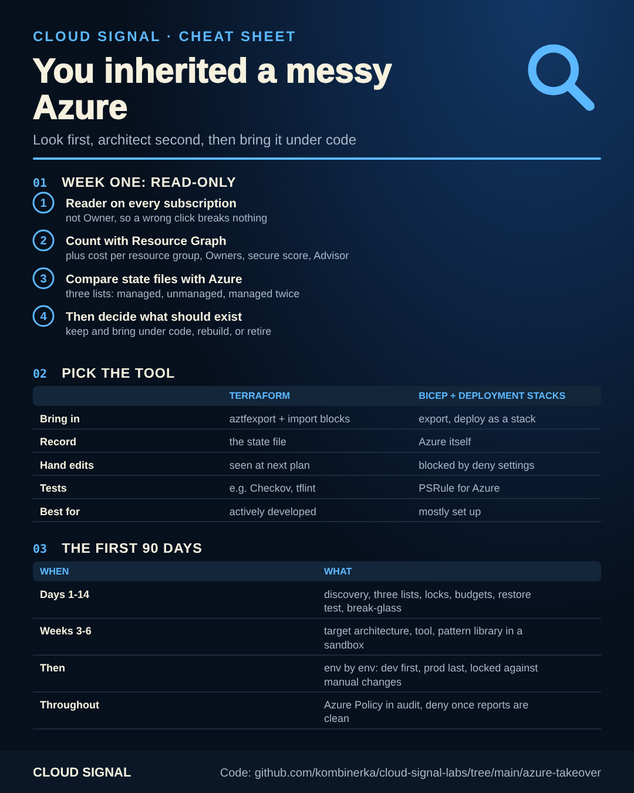

# Taking over a messy Azure estate

▶ **[Watch the video](https://www.youtube.com/watch?v=6RxuwNeM-to)**

Companion code for the Cloud Signal video **"You Inherited a Messy Azure Setup. Don't Start With Terraform."**



Eight environments, hundreds of resources each, half in Terraform and half clicked together in the portal, a thin
handover, and a client who wants it all "under code" in a few months. Importing everything is usually the wrong first
move. This folder follows the video: look first, decide the architecture, then pick **Terraform or Bicep**; both
options are here, side by side.

| Phase | Folder | What's in it |
|---|---|---|
| Look before you touch (read-only) | [`01-discover/`](01-discover/) | Resource Graph queries, an export script: inventory, Owners, cost per resource group, secure score, Advisor |
| What is already managed | [`02-whats-managed/`](02-whats-managed/) | [`compare.py`](02-whats-managed/compare.py): state files vs. Azure → managed, unmanaged, managed twice, stale |
| Stop the bleeding | [`03-stop-the-bleeding/`](03-stop-the-bleeding/) | Delete locks and budgets, in Terraform, Bicep and CLI |
| Option 1: Terraform, done properly | [`04-terraform-loop/`](04-terraform-loop/) | export → refactor → plan until only imports → apply, one resource group at a time |
| Option 2: Bicep + deployment stacks | [`05-deployment-stacks/`](05-deployment-stacks/) | Azure as the system of record, deny settings, PSRule as tests, pipelines for GitHub, Azure DevOps, GitLab |

## 1. Look before you touch

Ask for **Reader** on every subscription, not Owner. Then:

```bash
./01-discover/discover.sh     # writes discovery/<date>/*.json; changes nothing
```

The queries are also in [`queries.kql`](01-discover/queries.kql) for the Resource Graph Explorer in the portal.

## 2. What is already in Terraform?

Pull every state file you can find, and compare with Azure:

```bash
terraform -chdir=envs/dev state pull > states/dev.tfstate     # repeat per state
python3 02-whats-managed/compare.py --azure discovery/<date>/all-resources.json states/*.tfstate --out lists/
```

The faster way, if you accept one small change: add a `managed_by = "terraform"` tag to every resource in the
existing code, apply (development first), and query for everything without it (last query in `queries.kql`).

## 3. Architecture before engineering

Before importing anything, decide what should exist: do you need eight environments? Is this the network you would
design today? Sort every resource into **keep and bring under code**, **rebuild properly**, or **retire**. Sometimes
the best import is none: move the workload onto a platform you already run.

## 4. Pick the tool

| | Option 1: Terraform | Option 2: Bicep with deployment stacks |
|---|---|---|
| Bring existing resources in | `aztfexport` drafts + import blocks, plan until only imports ([`04-terraform-loop/`](04-terraform-loop/)) | `az group export --export-format bicep` drafts, what-if until no changes, deploy as a stack ([import-existing](../import-existing/)) |
| System of record | the state file | Azure itself (the stack) |
| Before a change | `terraform plan`: reliable, shows replacements | what-if: improving, can be noisy with existing references |
| Manual changes | detected at the next plan (see [drift-detection](../drift-detection/)) | blocked by deny settings (`denyWriteAndDelete`, up to 5 excluded principals) |
| Outside Azure | same tool for other clouds and SaaS | Azure only |
| Tests | e.g. Checkov, tflint, Terraform test | [PSRule for Azure](https://azure.github.io/PSRule.Rules.Azure/) (WAF rules) |
| Rule of thumb | actively developed infrastructure | mostly set up, changes little |

Either way, what matters more than the tool: stop manual changes, review every change in a pull request, and enforce
the rules with Azure Policy (managed as code, e.g. with [EPAC](https://azure.github.io/enterprise-azure-policy-as-code/)).

### The Terraform traps (option 1)

- Exported code is a draft: hard-coded values, and write-only properties (passwords) can't be exported.
- Dependencies outside the resource group, e.g. role assignments on the subscription.
- Child resources: subnets inline in the VNet *or* as separate resources. Pick one and keep it; Terraform manages
  exactly what you declare.
- Read every plan. Never apply to production while the plan shows something you can't explain.

## 5. The first ninety days

| When | What |
|---|---|
| Days 1-14 | read-only discovery, the three lists, locks, budgets, a restore test, break-glass accounts |
| Weeks 3-6 | target architecture and tool decision; pattern library in a sandbox; pipeline with tests |
| Then | environment by environment, development first, production last; each one under code and locked against manual changes |
| Throughout | Azure Policy in audit mode first, deny once the compliance reports are clean |

## Sources

- Azure Export for Terraform: https://learn.microsoft.com/en-us/azure/developer/terraform/azure-export-for-terraform/export-terraform-overview
- Terraform import blocks: https://developer.hashicorp.com/terraform/language/import
- Bicep deployment stacks: https://learn.microsoft.com/en-us/azure/azure-resource-manager/bicep/deployment-stacks
- PSRule for Azure: https://azure.github.io/PSRule.Rules.Azure/
- Enterprise Policy as Code (EPAC): https://azure.github.io/enterprise-azure-policy-as-code/
- Azure Resource Graph: https://learn.microsoft.com/en-us/azure/governance/resource-graph/overview
- The r/AZURE discussion that inspired the video: https://www.reddit.com/r/AZURE/comments/1x3w0xu/inherited_a_messy_azure_infrastructure_with/
