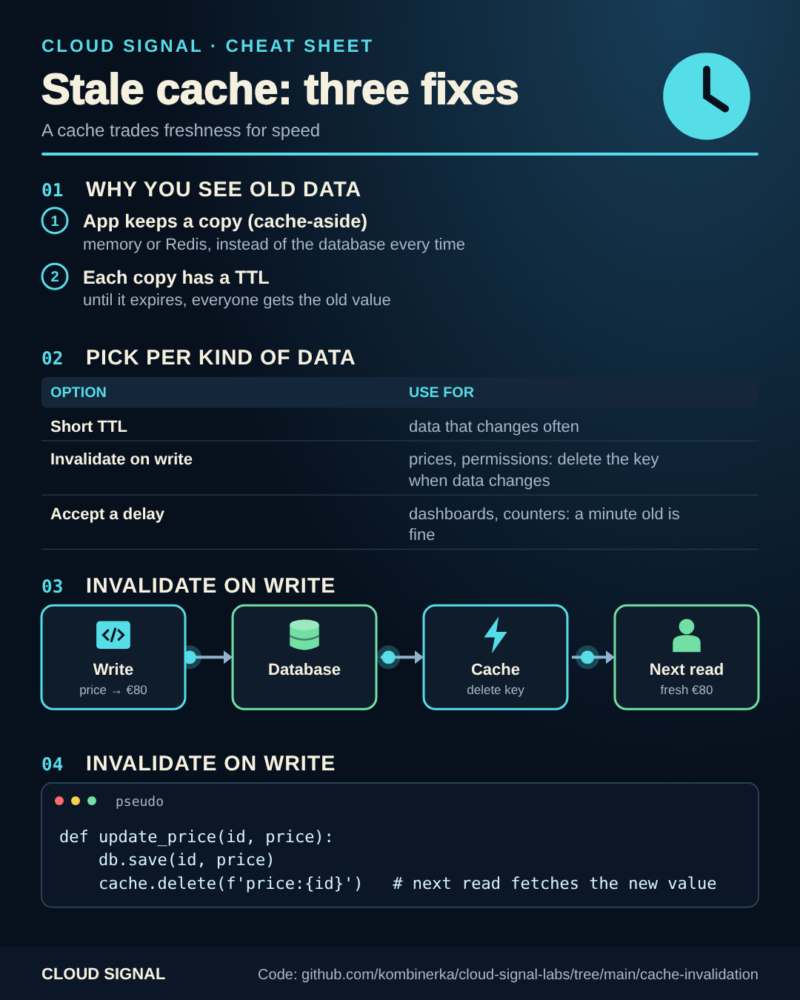

# Stale cache: three ways to deal with it

Companion code for the Cloud Signal Short **"You Changed the Price. Why Does the Website Still Show the Old One?"**



<sub>Static version for printing or sharing: [cheatsheet.png](cheatsheet.png)</sub>

An app keeps a copy of data (cache-aside) and serves it until its **time to live** expires. Until then, everyone
sees the old value. Pick per kind of data:

| Option | Use for |
|---|---|
| Short TTL | data that changes often and can be a few seconds old |
| Invalidate on write | prices, permissions, anything that must be right right after a change |
| Accept a delay | dashboards, counters, recommendations |

```bash
python3 cache.py
# long TTL, no invalidation   price seen at 1 s / 60 s / 700 s after the change: [100, 100, 80]
# short TTL                   price seen at 1 s / 60 s / 700 s after the change: [100, 80, 80]
# invalidate on write         price seen at 1 s / 60 s / 700 s after the change: [80, 80, 80]
python3 -m unittest test_cache.py
```

With several app instances, invalidation must reach every cache (a shared cache like Redis, or a message to all
instances), and a write racing a read can still put an old value back: keep a TTL as a safety net.

## Sources

- Microsoft: Cache-aside pattern: https://learn.microsoft.com/en-us/azure/architecture/patterns/cache-aside
