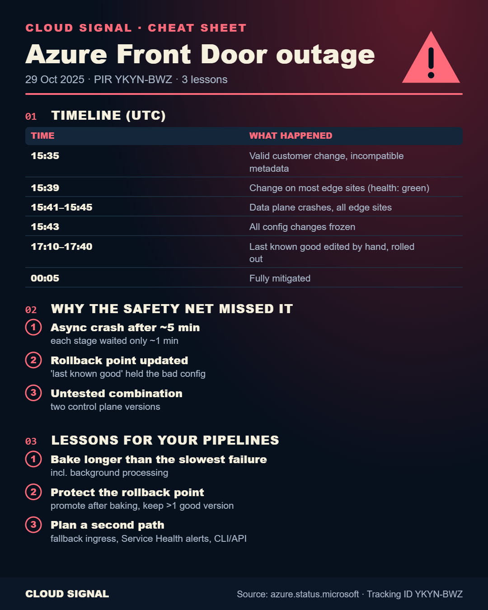

# Case File #1: Azure Front Door outage, 29 October 2025 (PIR YKYN-BWZ)

Companion to the Cloud Signal video **"Azure Front Door Outage Explained: How One Valid Config Change Went Global"** (and the Short "Why the Health Checks Said Green").

## Three lessons for your own pipelines

1. **A health check only proves what it waited long enough to see.** Bake time must be longer than the slowest failure you know about, including background processing. Front Door's stages advanced after about a minute; the crash came about five minutes later.
2. **Never let a rollout overwrite your rollback point until it has proven itself.** The "last known good" snapshot was updated with the bad configuration because the rollout looked successful. Keep more than one known good version.
3. **Plan for your front door to fail.** A second path for critical traffic, Azure Service Health alerts, and the CLI/API for when the portal itself is down.

## Sources

- Microsoft Post Incident Review YKYN-BWZ: https://azure.status.microsoft/en-us/status/history/?trackingId=YKYN-BWZ
- Azure Incident Retrospective video: https://aka.ms/air/YKYN-BWZ
- Mission-critical global HTTP ingress: https://learn.microsoft.com/azure/architecture/guide/networking/global-web-applications/mission-critical-global-http-ingress
