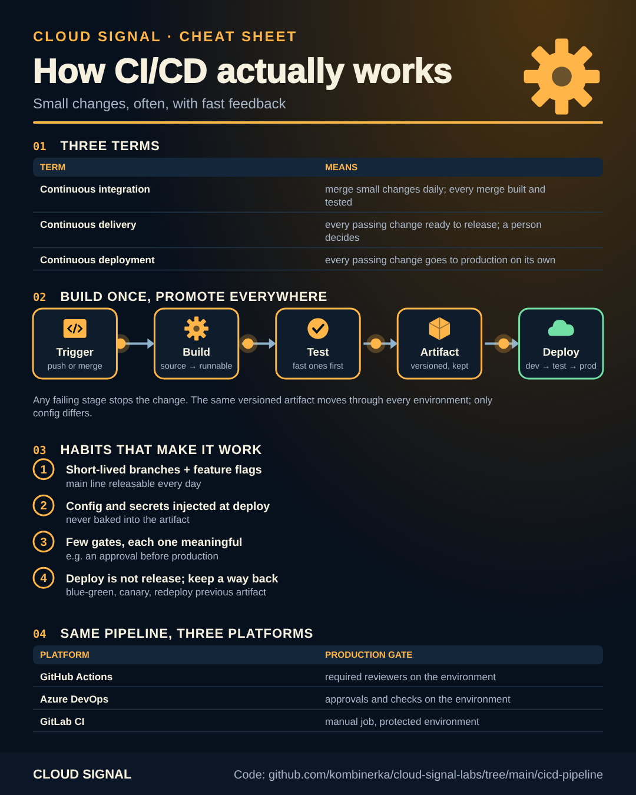

# A CI/CD pipeline, the same on three platforms

Companion code for the Cloud Signal explainer **"How CI/CD Actually Works — Without Naming a Single Tool"**.



<sub>Static version for printing or sharing: [cheatsheet.png](cheatsheet.png)</sub>

The video names no tools on purpose: the habits matter more than the product. Here is the same pipeline on
**GitHub Actions**, **Azure Pipelines** and **GitLab CI**, so you can see that only the syntax changes.

| Habit from the video | Where it is |
|---|---|
| Fast tests first, slower ones after | unit tests before the build, integration tests against the built artifact |
| Build once, promote everywhere | [`build.sh`](build.sh) makes one versioned artifact + checksum; every environment deploys that file |
| Configuration stays outside | [`config/<env>.env`](config/) injected at deploy time ([`deploy.sh`](deploy.sh)), never baked in |
| Pipeline as code | the pipeline files below live next to the app |
| Gates that mean something | production waits for an approval on the environment, nothing else is manual |
| A way back | redeploy the previous artifact: every version is kept |

| Platform | Files | Production gate |
|---|---|---|
| GitHub Actions | [`github/.github/workflows/pipeline.yml`](github/.github/workflows/pipeline.yml) + reusable [`deploy.yml`](github/.github/workflows/deploy.yml) | required reviewers on the `production` environment |
| Azure Pipelines | [`azure-devops/azure-pipelines.yml`](azure-devops/azure-pipelines.yml) + [`deploy-stage.yml`](azure-devops/deploy-stage.yml) template | approvals and checks on the `production` environment |
| GitLab CI | [`gitlab/.gitlab-ci.yml`](gitlab/.gitlab-ci.yml) | manual job on a protected environment with approvals |

The app is deliberately tiny ([`app/shop.py`](app/shop.py)); the deploy step only prints what it would do, with
examples of a real one in [`deploy.sh`](deploy.sh). Try it locally:

```bash
VERSION=1.0.0 ./build.sh
ARTIFACT=dist/shop-1.0.0.tar.gz python3 -m unittest discover -s tests -t .
./deploy.sh staging dist/shop-1.0.0.tar.gz
```

## Environments as code

The video's "environments as code" chapter: describe the environments in Terraform or Bicep and let the pipeline
apply them. Examples elsewhere in this repo: [deployment-slots](../deployment-slots/) (an app with a staging slot),
[drift-detection](../drift-detection/) (catch hand-made changes) and [oidc-deploy](../oidc-deploy/) (sign in to
Azure without a stored secret, the "protect the pipeline" chapter). Pinning the tools the pipeline pulls in:
[pin-dependencies](../pin-dependencies/).

## Sources

- DORA research program: https://dora.dev/
- Martin Fowler: Continuous Integration: https://martinfowler.com/articles/continuousIntegration.html
