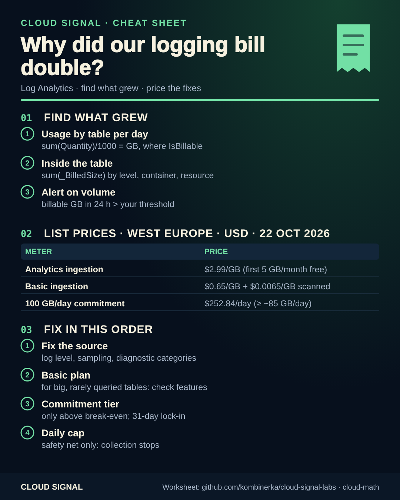

# Cloud Math #1: Why did our logging bill double? (Log Analytics)

Companion code for the Cloud Signal video **"Log Analytics Cost: Why Our Azure Logging Bill Doubled (and 4 Fixes, Priced)"**.

## The workload (fictional) and the assumptions

One workspace for a shop on AKS, one 30-day month, list prices for West Europe in USD from the Azure Retail Prices API
on 2026-10-22 ([`prices.json`](prices.json)): Analytics ingestion $2.99/GB after the first 5 GB/month, Basic $0.65/GB,
Basic queries $0.0065/GB scanned, 100 GB/day commitment tier $252.84/day.

| Volume (GB/day) | Before | After a debug release |
|---|---|---|
| Other tables | 15 | 15 |
| ContainerLogV2 | 5 | 25 |

## The result ([`worksheet.py`](worksheet.py))

| Option | $/month |
|---|---:|
| Before (info) | 1,779.05 |
| After (debug left on) | 3,573.05 |
| A: 100 GB/day commitment tier | 7,585.20 |
| B: ContainerLogV2 on Basic, still debug (+2 TB queries) | 1,831.05 |
| C: log level back to info | 1,779.05 |
| C + B | 1,441.05 |

The commitment tier breaks even at about 84.6 GB/day. A daily cap stops collection for the rest of the day: a safety
net, not a fix. Transformations that drop more than 50 % of incoming data are charged for the filtered part above 50 %
(Analytics/Basic, no Sentinel), so fix noise at the source first.

## Files

| File | What |
|---|---|
| [`queries.kql`](queries.kql) | which table grew (Usage), which level/container (`_BilledSize`), the daily volume alert |
| [`worksheet.py`](worksheet.py) | the math; change the GB/day to yours |
| [`fetch_prices.py`](fetch_prices.py) | current list prices for your region (`python3 fetch_prices.py northeurope`) |
| [`set-basic-plan.sh`](set-basic-plan.sh) | move one table to the Basic plan with `az` (check feature support and alerts first) |

## Sources

- https://learn.microsoft.com/en-us/azure/azure-monitor/logs/cost-logs
- https://learn.microsoft.com/en-us/azure/azure-monitor/logs/analyze-usage
- https://learn.microsoft.com/en-us/azure/azure-monitor/logs/logs-table-plans
- https://learn.microsoft.com/en-us/azure/azure-monitor/data-collection/data-collection-transformations
- https://learn.microsoft.com/en-us/rest/api/cost-management/retail-prices/azure-retail-prices

Validated: `worksheet.py` runs (output above), `bash -n set-basic-plan.sh`. `fetch_prices.py` was checked against the
live API on 2026-10-22. Not run against a live workspace.
