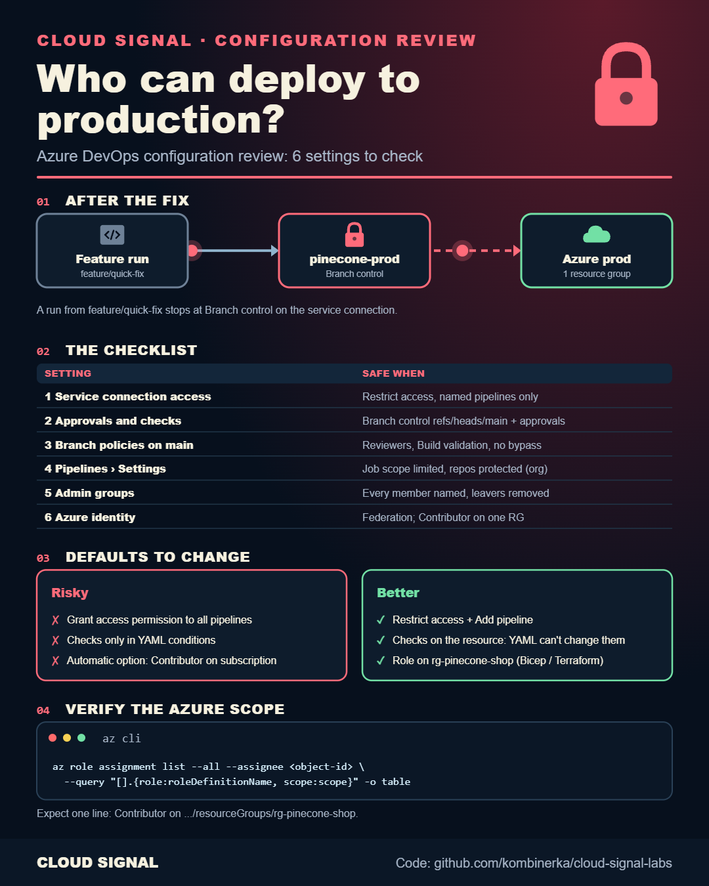

# Azure DevOps Production Deployments: 6-Point Security Review

Static version: [cheatsheet.png](cheatsheet.png)

Companion to the Cloud Signal video (Configuration Review #1): can a feature branch deploy to production in your
Azure DevOps project? The six settings reviewed:

1. Service connection pipeline permissions (Open access vs Restrict access)
2. Approvals and checks: Branch control (`refs/heads/main`) on the service connection, Approvals on the environment
3. Branch policies on `main`
4. Pipeline settings: Limit job authorization scope, Protect access to repositories in YAML pipelines
5. People: Project Administrators, Build Administrators, the service connection's Administrator role
6. The Azure identity: workload identity federation, Contributor on one resource group, not the subscription

| File | What it is |
|---|---|
| `azure-pipelines.yml` | deployment job to the `production` environment |
| `role-assignment.bicep` | Contributor on one resource group for the pipeline identity (Bicep) |
| `role-assignment.tf`, `versions.tf` | the same in Terraform |
| `verify.sh` | Azure CLI checks for the role scope |
| `VALIDATION.md` | how it was checked |
| `cheatsheet.png`, `cheatsheet-animated.png` | the six-point checklist on one page (static and animated) |

The protections themselves are project settings (not code); the video shows where each one lives. Validated, **not deployed**.
