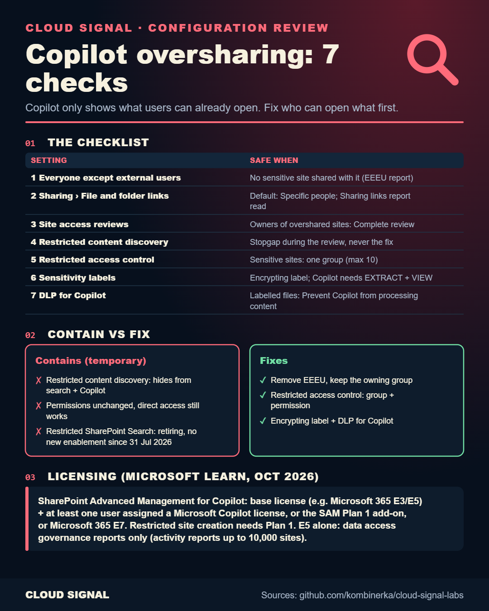

# Microsoft 365 Copilot Oversharing: 7 Checks Before You Turn It On

▶ **[Watch the video](https://www.youtube.com/watch?v=aNG4NHd_bGI)** · Short: [The HR Site Everyone Can Open](https://www.youtube.com/watch?v=MzZoILfiwWI)

Companion to the Cloud Signal video (Configuration Review #2). Copilot only shows what a user can already open, so an
HR site shared years ago with "Everyone except external users" becomes something any employee can ask about. The video
walks through seven settings in a fictional company (Pinecone) and ends with a checklist to run before rollout.

| File | What it is |
|---|---|
| `check-hr-site.ps1` | the stopgap from the video for one site: turns on restricted content discovery (keeps it out of Copilot and org-wide search) and, if you pass group IDs, restricted access control. **It changes the site**; the last line shows how to undo the first step |
| `VALIDATION.md` | how it was checked |

Syntax-checked (PowerShell 7, 0 parse errors), **not run against any tenant** (see VALIDATION.md). Read it before you run it. Names are fictional (Pinecone).
