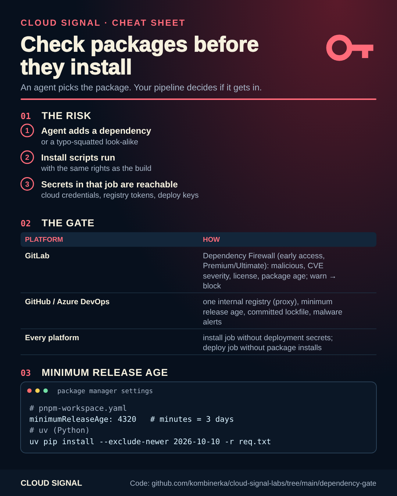

# Check packages before they install

Companion code for the Cloud Signal Short **"Your AI Agent Installed One Package. Could It Steal Your Secrets?"**

An AI agent (or a person) can pick a malicious or typo-squatted package. Its install scripts run with the same rights
as the build, so any secret in that job is reachable. Two defences, together:

**1. A gate before install**

| Platform | Gate |
|---|---|
| GitLab | Dependency Firewall (early access, Premium/Ultimate): block malicious packages, critical vulnerabilities, denied licenses and versions younger than a minimum age; warn mode first, then block |
| GitHub / Azure DevOps / any | one internal registry that proxies the public one (Azure Artifacts upstream sources, GitLab, Artifactory, Nexus), a minimum release age, a committed lockfile, no install scripts by default |

Package manager settings: [`package-managers/`](package-managers/): pnpm `minimumReleaseAge`, npm `ignore-scripts`,
uv `exclude-newer`.

**2. No secrets where packages install**

| Platform | File |
|---|---|
| GitHub Actions | [`github/.github/workflows/build-deploy.yml`](github/.github/workflows/build-deploy.yml): build job without credentials, deploy job with OIDC only |
| GitLab CI | [`gitlab/.gitlab-ci.yml`](gitlab/.gitlab-ci.yml): deployment variables scoped to the `production` environment |
| Azure Pipelines | [`azure-devops/azure-pipelines.yml`](azure-devops/azure-pipelines.yml): service connection only in the deploy stage |

The agent picks the package. Your pipeline decides if it gets in.

## Sources

- GitLab: Dependency Firewall: https://about.gitlab.com/blog/transcend-dependency-firewall/
- pnpm: minimumReleaseAge: https://pnpm.io/settings#minimumreleaseage
- uv: exclude-newer: https://docs.astral.sh/uv/reference/settings/#exclude-newer
- npm: ignore-scripts: https://docs.npmjs.com/cli/v11/using-npm/config#ignore-scripts
