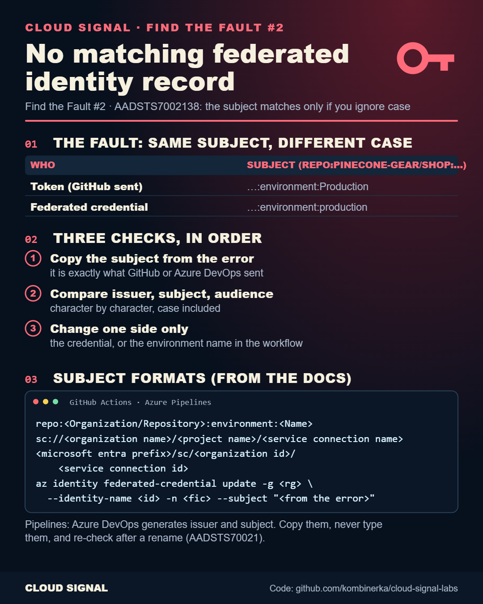

# Azure Login AADSTS7002138: Fix the Federated Credential Case Mismatch

▶ **[Watch the video](https://www.youtube.com/watch?v=p1ojtSemk4A)** · Short: [The Error Tells You It's the Case](https://www.youtube.com/watch?v=RLyxIn8Wh-w)

Companion to the Cloud Signal video (Find the Fault #2). A GitHub Actions deploy fails at `azure/login` with
AADSTS7002138 ("No matching federated identity record found for presented assertion subject"): the token's subject
ends in `environment:Production`, the federated credential says `environment:production`.

The three checks, in order:
1. Copy the subject from the error message: it is exactly what GitHub or Azure DevOps sent.
2. List the federated credentials on the identity and compare issuer, subject and audience character by character, case included.
3. Fix the credential (or the environment name) so they match exactly.

| File | What it is |
|---|---|
| `main.bicep` | user-assigned identity + federated credential (Bicep) |
| `main.tf`, `versions.tf` | the same in Terraform |
| `github-deploy.yml`, `azure-pipelines.yml` | the deploy pipelines (OIDC, no stored secret) |
| `check-subject.sh` | compares the subject from the error with the credentials on the identity |
| `VALIDATION.md` | how it was checked |

Validated (bicep build, terraform validate), **not deployed**. Names are fictional (Pinecone).
