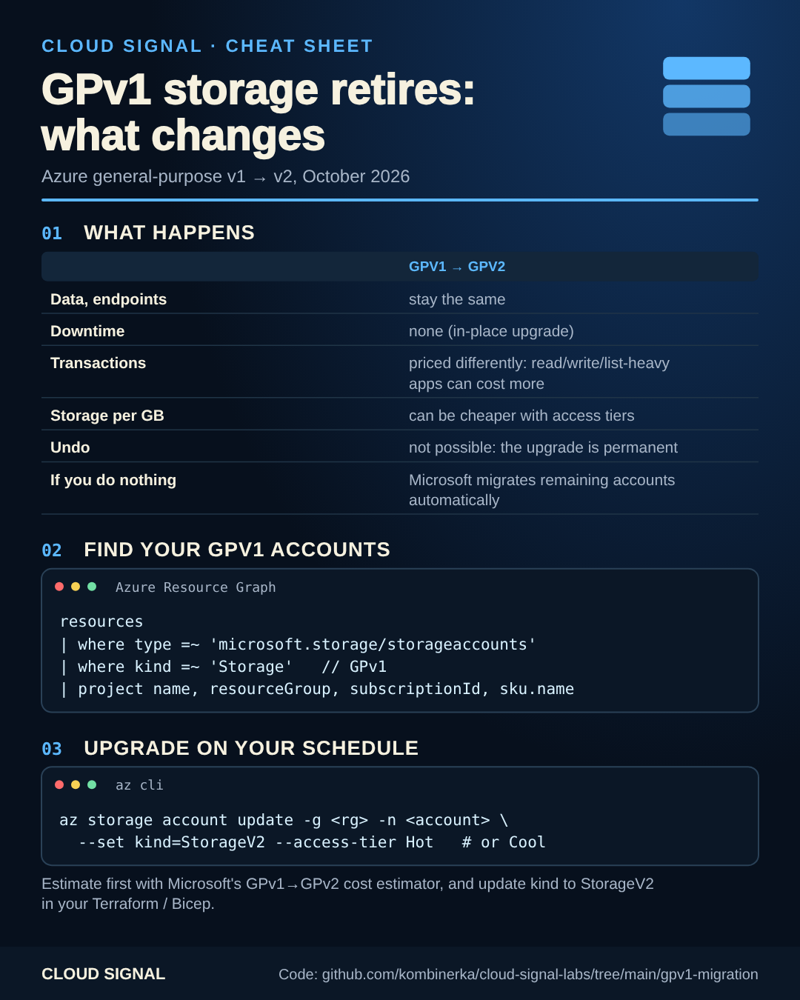

# GPv1 storage retires: upgrade on your own schedule

Companion code for the Cloud Signal Short **"Azure Is Retiring GPv1 Storage This Month. Could Your Bill Change?"**

General-purpose v1 storage accounts retire in October 2026; Microsoft migrates any that are left to general-purpose v2.
The upgrade is in place: no downtime, same data, same endpoints. But GPv2 prices **transactions** differently, so
read/write/list-heavy workloads can cost more, and the upgrade **can't be undone**.

| Step | How |
|---|---|
| 1. Find GPv1 accounts | [`find-and-upgrade.sh`](find-and-upgrade.sh) (Resource Graph, all subscriptions you can read) |
| 2. Estimate the cost | Microsoft's GPv1 → GPv2 cost estimator (linked from the migration overview) with your real transaction counts |
| 3. Choose the access tier | Hot or Cool, per account, before upgrading |
| 4. Upgrade | `TIER=Hot ./find-and-upgrade.sh --upgrade` (asks per account) or the portal |
| 5. Update your code | Terraform: [`terraform/main.tf`](terraform/main.tf) · Bicep: [`bicep/main.bicep`](bicep/main.bicep): `StorageV2` + the tier |

Azure Files and managed disks pricing isn't affected by the account kind change; Blob Storage is.

## Sources

- Microsoft Learn: General-purpose v1 account migration overview: https://learn.microsoft.com/en-us/azure/storage/common/general-purpose-version-1-account-migration-overview
- Microsoft Learn: Upgrade to a general-purpose v2 storage account: https://learn.microsoft.com/en-us/azure/storage/common/storage-account-upgrade
