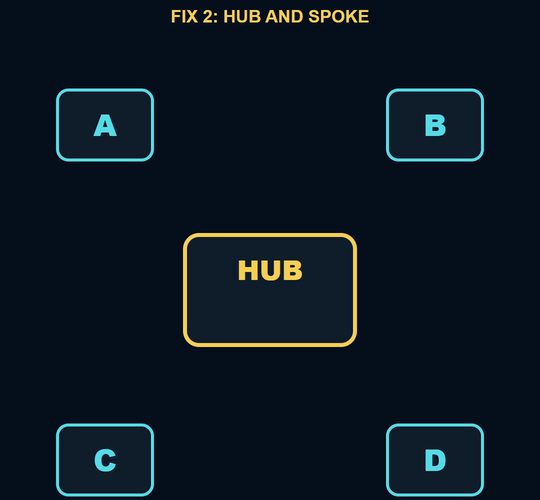

# Peering isn't transitive: direct links or a hub

Companion code for the Cloud Signal Short **"Why A Can't Reach C in Azure (Peering Isn't Transitive)"**.

A is peered with B, B with C, and a packet from A to C never arrives. A peering connects exactly two networks;
traffic doesn't hop through a third one on its own. Two ways to connect A and C:

| | Direct peering | Hub and spoke |
|---|---|---|
| When | two or three networks | many networks |
| How | peer A and C with each other (both directions) | every spoke peers with the hub; a firewall/NVA in the hub forwards between spokes, steered by user-defined routes |
| Links | grows fast: n × (n-1) / 2 | one per spoke |
| Inspection | none in between | everything passes the hub firewall |
| Terraform | [`terraform/direct-peering.tf.example`](terraform/direct-peering.tf.example) | [`terraform/main.tf`](terraform/main.tf) |
| Bicep | two `virtualNetworkPeerings` between the spokes | [`bicep/main.bicep`](bicep/main.bicep) |

The examples create the hub, two spokes (A and C), the peerings in both directions with forwarded traffic allowed,
and a route table on each spoke that sends traffic for the other spokes to the firewall's private IP. The firewall
itself is left out because it costs money while it runs: add Azure Firewall (or an NVA with IP forwarding) at
`10.0.0.4` with rules that allow the traffic. Azure Virtual Network Manager can also create and maintain hub-and-spoke
or mesh connectivity for you at scale.

The [landing-zone](../landing-zone/) folder puts the hub in its own Connectivity subscription.

## Sources

- Microsoft: Virtual network peering: https://learn.microsoft.com/en-us/azure/virtual-network/virtual-network-peering-overview
- Microsoft: Hub-spoke network topology in Azure: https://learn.microsoft.com/en-us/azure/architecture/networking/architecture/hub-spoke
- Microsoft: Virtual network traffic routing (user-defined routes): https://learn.microsoft.com/en-us/azure/virtual-network/virtual-networks-udr-overview
