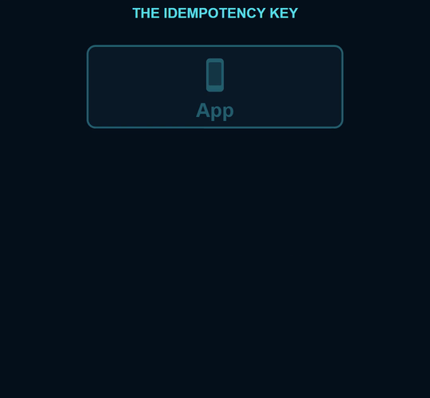
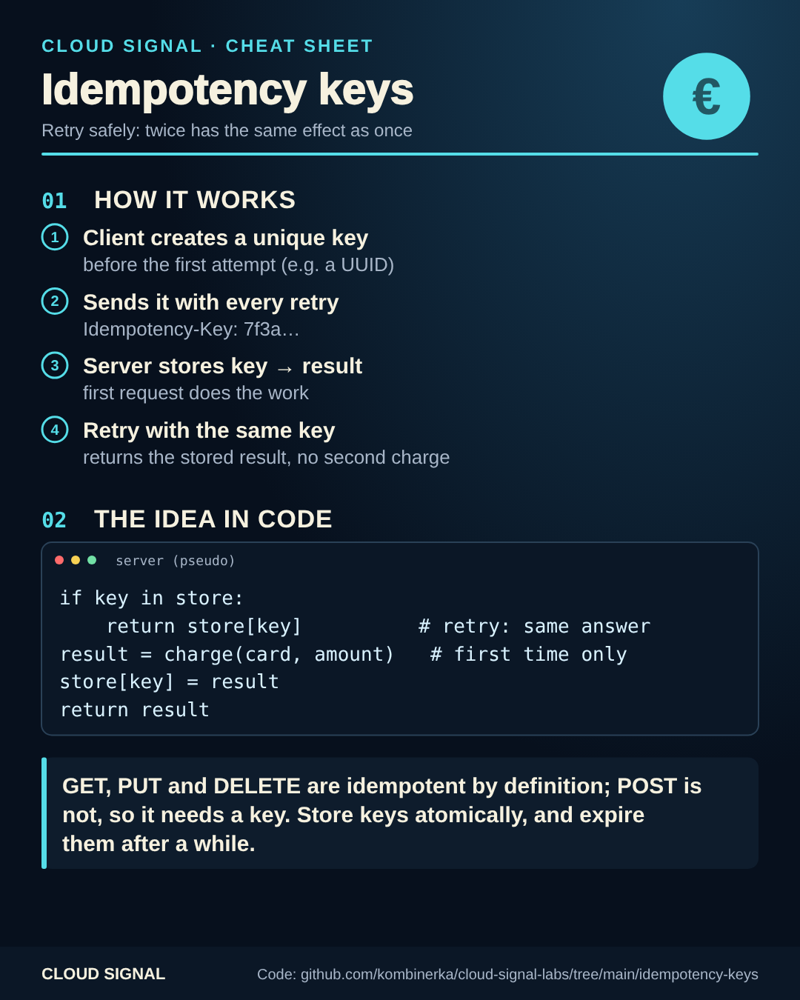

# Idempotency keys: retry without paying twice

Companion code for the Cloud Signal Short **"You Clicked Pay Twice. Were You Charged Twice?"**





A request is **idempotent** when doing it twice has the same effect as doing it once. Payments aren't, by nature:
every POST could be a new charge. The fix is an idempotency key:

1. The client creates a unique key **before** the first attempt and sends it with every retry.
2. The server stores key → result. The first request charges the card and stores the result.
3. A retry with the same key gets the stored result back. No second charge.

```bash
python3 payments.py
python3 -m unittest test_payments.py     # includes 20 parallel retries -> 1 charge
```

In production: store keys in a database or cache with an atomic insert (not an in-memory dict), keep them for a
limited time (Stripe keeps them 24 hours), and reject a reused key with a *different* request body.

## Sources

- Stripe API: Idempotent requests: https://docs.stripe.com/api/idempotent_requests
- IETF draft: The Idempotency-Key HTTP Header Field: https://datatracker.ietf.org/doc/draft-ietf-httpapi-idempotency-key-header/
