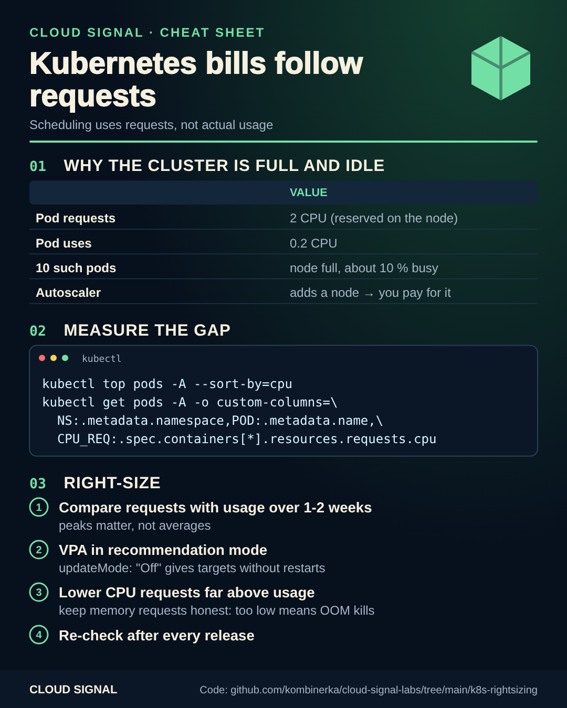

# Kubernetes bills follow requests

Companion code for the Cloud Signal Short **"Your Kubernetes Cluster Is Full. Your Nodes Are Idle. How?"**

The scheduler places pods by their **requests**, not by what they use. A pod that requests 2 CPUs reserves 2 CPUs
even if it uses 0.2. Nodes fill up while sitting mostly idle, and the cluster autoscaler adds nodes you pay for.

| Step | File |
|---|---|
| See the gap today | [`requests-vs-usage.sh`](requests-vs-usage.sh): requests vs. `kubectl top`, sorted by unused CPU |
| Get recommendations over time | [`vpa-recommend.yaml`](vpa-recommend.yaml): VPA with `updateMode: "Off"` (recommends, never restarts) |
| Right-size | lower CPU requests far above usage; keep memory requests close to real peaks (too low = OOM kills) |
| Keep it right | re-check after every release; new versions use resources differently |

On AKS, enable the VPA add-on with `az aks update -g <rg> -n <aks> --enable-vpa`. Look at peaks, not averages,
and change requests in your manifests or Helm values (in Git), not with `kubectl edit`.

## Sources

- Kubernetes: Resource Management for Pods and Containers: https://kubernetes.io/docs/concepts/configuration/manage-resources-containers/
- Vertical Pod Autoscaler: https://github.com/kubernetes/autoscaler/tree/master/vertical-pod-autoscaler
- AKS: Vertical Pod Autoscaling: https://learn.microsoft.com/en-us/azure/aks/vertical-pod-autoscaler
