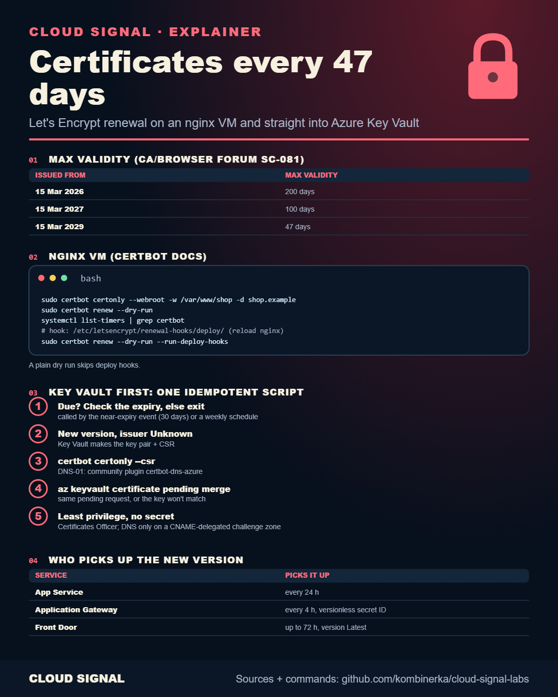

# TLS Certificates Every 47 Days: Auto-Renew Let's Encrypt into Azure Key Vault

▶ **[Watch the video](https://www.youtube.com/watch?v=1hBxR0JpedM)** · Short: [Certbot Deploy Hook: Why a Renewed Certificate Still Expires](https://www.youtube.com/watch?v=GDnJnClKihA)

Under CA/Browser Forum ballot SC-081, publicly trusted TLS certificates issued from 15 March 2026 can be valid for at
most 200 days, from 15 March 2027 100 days and from 15 March 2029 47 days. Renewal has to be automated.

| Folder | What it is |
|---|---|
| [`vm/`](vm/) | certbot on a Linux VM: issue, check the renewal timer, install a deploy hook that reloads the web server |
| [`keyvault/`](keyvault/) | Key Vault-first renewal: Key Vault makes the key pair and CSR, `certbot certonly --csr` with DNS-01, then `az keyvault certificate pending merge`. The private key never leaves Key Vault |
| `VALIDATION.md` | what was checked against the docs, and what was not run |

Start against the Let's Encrypt **staging** environment. Commands follow the certbot, Let's Encrypt and Microsoft
Learn docs; **not run against a live system**. Names are fictional (Pinecone).
