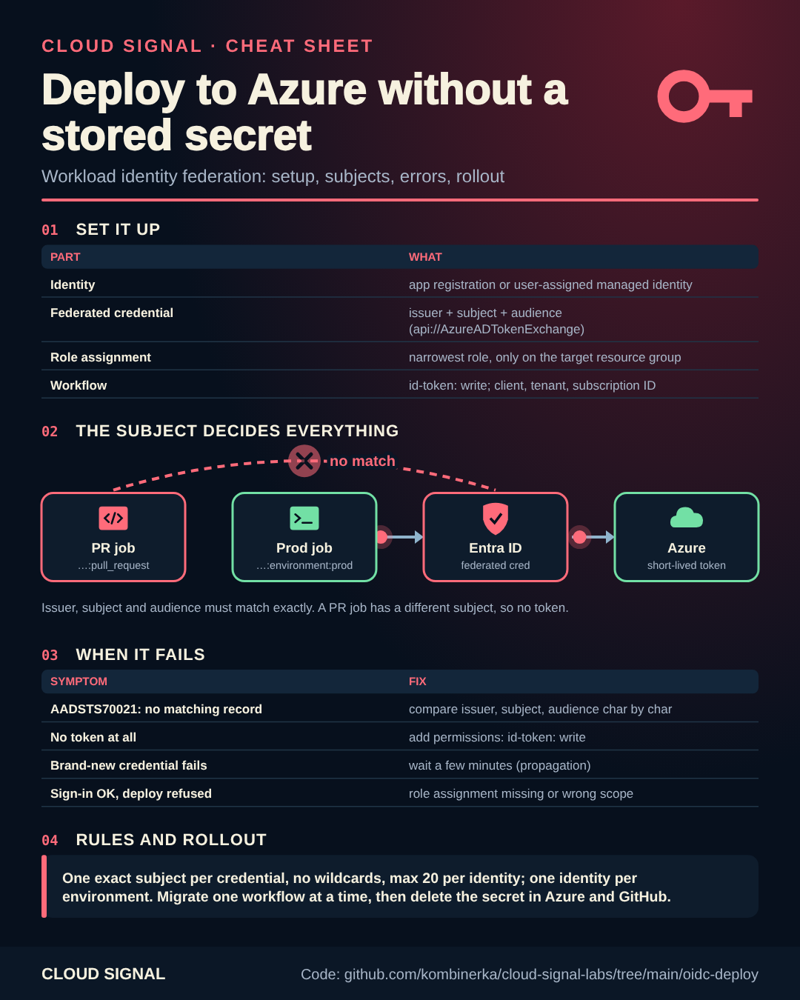

# Deploy to Azure without a stored secret (workload identity federation)

Companion code for the Cloud Signal videos **"GitHub Actions → Azure Without a Secret, in 2 Minutes"** and
**"Deploy to Azure Without a Stored Secret (GitHub Actions OIDC)"**.

Static version: [cheatsheet.png](cheatsheet.png) · the 2-minute version's sheet: [cheatsheet-short.png](cheatsheet-short.png) ([animated](cheatsheet-short-animated.png))

A client secret in your CI system is a password that works from anywhere until someone rotates it. With workload
identity federation the job proves *where it runs* instead: the CI system signs a short-lived token describing the
job, Microsoft Entra ID checks it against a federated credential, and Azure returns an access token that expires with
the job. Nothing reusable is stored.

## Set up the Azure side (once per environment)

Three parts: an identity, a federated credential (one exact subject), one narrow role.

Pick one; all three create the same thing:

| Option | File | Run |
|---|---|---|
| Terraform | [`setup/identity.tf`](setup/identity.tf) | `terraform apply -var github_repo=my-org/my-app -var target_resource_group=rg-app-prod` |
| Bicep | [`setup/identity.bicep`](setup/identity.bicep) | `az deployment group create -g rg-app-prod -f setup/identity.bicep -p githubRepo=my-org/my-app` |
| Azure CLI | [`setup/create-identity.sh`](setup/create-identity.sh) | `GITHUB_REPO=my-org/my-app TARGET_RG=rg-app-prod ./setup/create-identity.sh` |

The examples trust a GitHub environment. For GitLab or Azure DevOps, change issuer and subject (table below).
Use one identity per environment, so a mistake in development can't reach production.

## The pipeline side

| Platform | File | Issuer | Subject |
|---|---|---|---|
| GitHub Actions | [`github/.github/workflows/deploy.yml`](github/.github/workflows/deploy.yml) | `https://token.actions.githubusercontent.com` | `repo:<owner>/<repo>:environment:<env>` |
| GitLab CI | [`gitlab/.gitlab-ci.yml`](gitlab/.gitlab-ci.yml) | `https://gitlab.com` | `project_path:<group>/<project>:ref_type:branch:ref:<branch>` |
| Azure Pipelines | [`azure-devops/azure-pipelines.yml`](azure-devops/azure-pipelines.yml) | created for you by the service connection | `sc://<org>/<project>/<connection>` |

Audience: `api://AzureADTokenExchange` for GitHub and Azure DevOps; for GitLab, whatever you put in `aud`
(the example uses `https://gitlab.com`).

## GitHub subjects

The subject depends on how the job runs, and each subject needs its own credential:

| Job | Subject |
|---|---|
| uses `environment: production` | `repo:my-org/my-app:environment:production` |
| pull request, no environment | `repo:my-org/my-app:pull_request` |
| push to a branch, no environment | `repo:my-org/my-app:ref:refs/heads/main` |
| tag | `repo:my-org/my-app:ref:refs/tags/v1.2.3` |

Environments are the strongest option: add required reviewers, and Azure only trusts jobs that passed the approval.

## When it fails

| Error | Meaning |
|---|---|
| `AADSTS70021: No matching federated identity record found` (`AADSTS7002138` when only upper/lower case differs) | The token is valid but no credential matches. Compare issuer, subject (case-sensitive) and audience character by character. A job without `environment:` or a pull request produces a different subject. |
| No token at all / `Unable to get ACTIONS_ID_TOKEN_REQUEST_URL` | The job lacks `permissions: id-token: write`. |
| Works for a new credential only after a few minutes | Propagation; retry after a short wait. |
| Sign-in works, deployment refused (`AuthorizationFailed`) | Federation worked. The role assignment is missing or on the wrong scope. |

## Rolling it out

1. Inventory: in Entra, list app registrations with client secrets and their expiry; in your CI system, list the
   secrets that hold Azure credentials.
2. Migrate one workflow at a time: add the federated credential next to the old secret, switch the workflow, run it.
3. Check the service principal sign-in logs in Entra: you see federated sign-ins arrive and the secret go quiet.
4. Delete the secret, in Azure and in the CI system.

## Sources

- Microsoft: Configure an app or identity to trust an external identity provider: https://learn.microsoft.com/en-us/entra/workload-id/workload-identity-federation-create-trust
- GitHub: OpenID Connect in Azure: https://docs.github.com/en/actions/how-tos/secure-your-work/security-harden-deployments/oidc-in-azure
- GitLab: Azure OIDC: https://docs.gitlab.com/ci/cloud_services/azure/
- Azure DevOps: Workload identity federation service connections: https://learn.microsoft.com/en-us/azure/devops/pipelines/library/connect-to-azure
