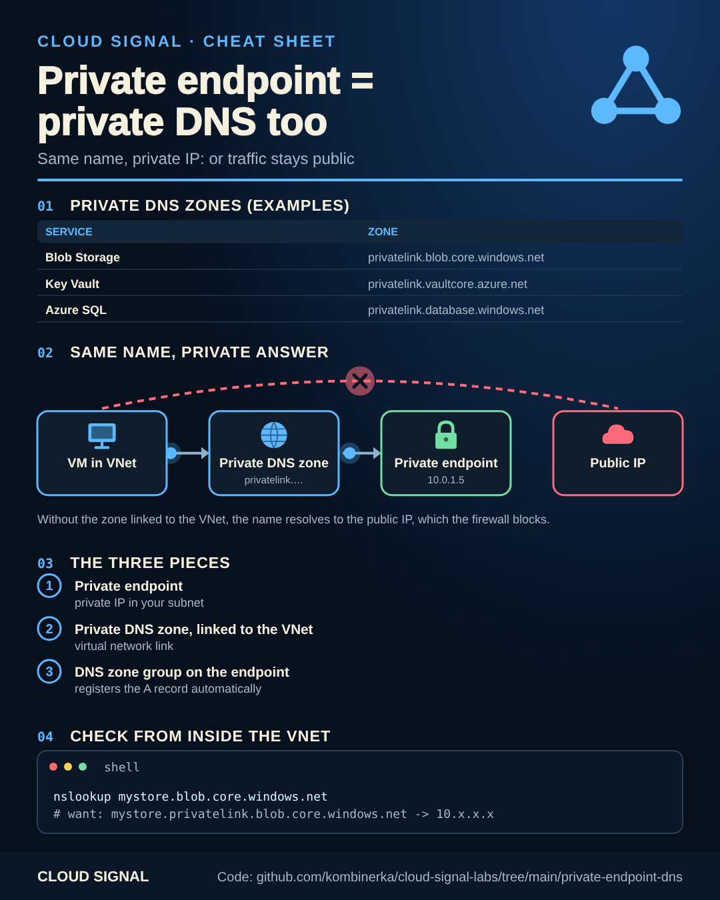

# Private endpoint = private DNS too

Companion code for the Cloud Signal Short **"Private Endpoint Added. Why Is Traffic Still Public?"**

Static version for printing or sharing: [cheatsheet.png](cheatsheet.png)

A private endpoint gives a service a private IP in your subnet, but your app connects to a **name**. If
`mystore.blob.core.windows.net` still resolves to the public address, traffic goes the public way, or fails once
public access is off. Three pieces make it private:

1. a **private DNS zone** for the service (`privatelink.blob.core.windows.net` for Blob),
2. a **virtual network link** from the zone to your VNet,
3. a **DNS zone group** on the endpoint, which registers its A record automatically.

| | File |
|---|---|
| Terraform | [`terraform/main.tf`](terraform/main.tf) |
| Bicep | [`bicep/main.bicep`](bicep/main.bicep) |
| Check from inside the VNet | [`check-dns.sh`](check-dns.sh) |

Hub-and-spoke: keep the private DNS zones once, centrally (e.g. in the connectivity subscription, see
[landing-zone](../landing-zone/)), linked to every VNet that needs them. With your own DNS servers or on-premises
clients, forward the `privatelink` zones to Azure DNS or a DNS Private Resolver.

## Sources

- Microsoft Learn: Azure Private Endpoint DNS configuration: https://learn.microsoft.com/en-us/azure/private-link/private-endpoint-dns
- Microsoft Learn: Private DNS zone values per service: https://learn.microsoft.com/en-us/azure/private-link/private-endpoint-dns#azure-services-dns-zone-configuration
