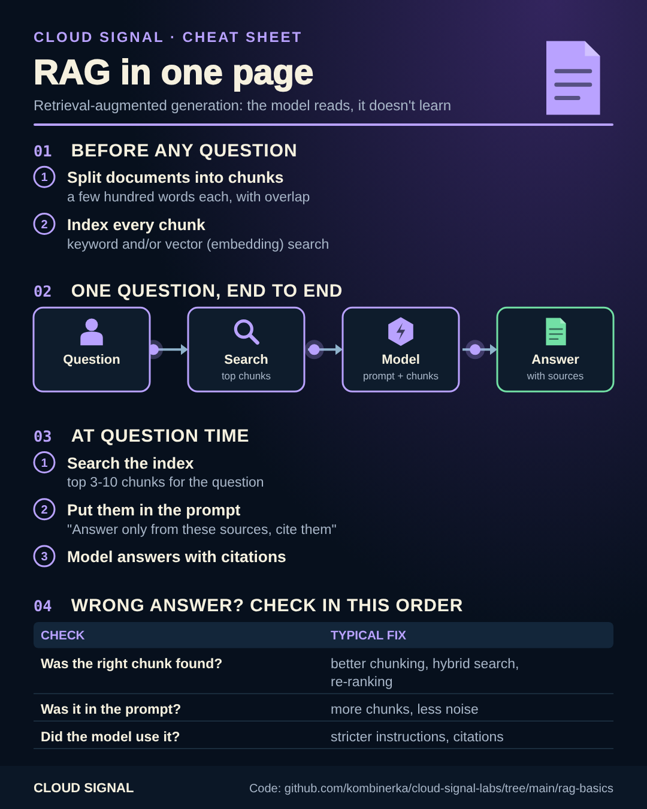

# RAG in 60 lines

Companion code for the Cloud Signal Short **"How Does AI Answer From Documents It Was Never Trained On?"**



<sub>Static version for printing or sharing: [cheatsheet.png](cheatsheet.png)</sub>

Retrieval-augmented generation: the model doesn't learn your documents, it **reads** them at question time.
[`rag.py`](rag.py) shows every step with the standard library only:

1. **Chunk**: split documents into overlapping pieces.
2. **Index**: make every chunk searchable (TF-IDF here; embeddings in real systems).
3. **Retrieve**: find the chunks most related to the question.
4. **Prompt**: put them next to the question with "answer only from these sources, cite them". Send that to any LLM.

```bash
python3 rag.py "How much can I spend on meals?"     # retrieves expenses.md
python3 rag.py "my notebook won't start"           # finds nothing: no shared words with "laptop fails to boot"
```

The second example is why embeddings exist: keyword search can't match meaning, which
is why real RAG systems use vector or hybrid search. When an answer is wrong, check retrieval first: was the right
chunk found, was it in the prompt, did the model use it?

## Sources

- Lewis et al.: Retrieval-Augmented Generation for Knowledge-Intensive NLP Tasks: https://arxiv.org/abs/2005.11401
- Microsoft: RAG in Azure AI Search: https://learn.microsoft.com/en-us/azure/search/retrieval-augmented-generation-overview
