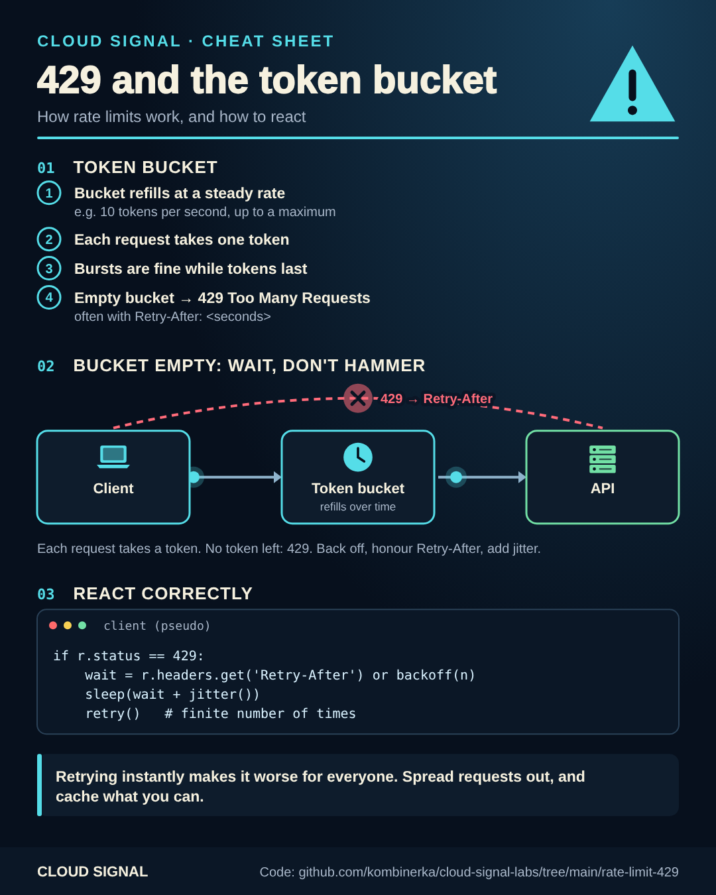

# 429 Too Many Requests and the token bucket

Companion code for the Cloud Signal Short **"429 Too Many Requests: What Actually Happened?"**



<sub>Static version for printing or sharing: [cheatsheet.png](cheatsheet.png)</sub>

A 429 means you hit the API's rate limit. A common way to enforce one is a **token bucket**: it refills at a steady
rate (say 10 per second), every request takes a token, bursts are fine while tokens last, and an empty bucket answers
429, often with a `Retry-After` header.

| File | What |
|---|---|
| [`ratelimit.py`](ratelimit.py) | `TokenBucket` (server side) and `call_with_respect` (client: waits `Retry-After`, backs off, adds jitter, gives up eventually) |
| [`test_ratelimit.py`](test_ratelimit.py) | burst, refill and Retry-After tests |

```bash
python3 ratelimit.py
python3 -m unittest test_ratelimit.py
```

Retrying a 429 immediately makes it worse for everyone. See also [retry-backoff](../retry-backoff/) for why jitter
matters.

## Sources

- MDN: 429 Too Many Requests: https://developer.mozilla.org/en-US/docs/Web/HTTP/Status/429
- MDN: Retry-After: https://developer.mozilla.org/en-US/docs/Web/HTTP/Headers/Retry-After
