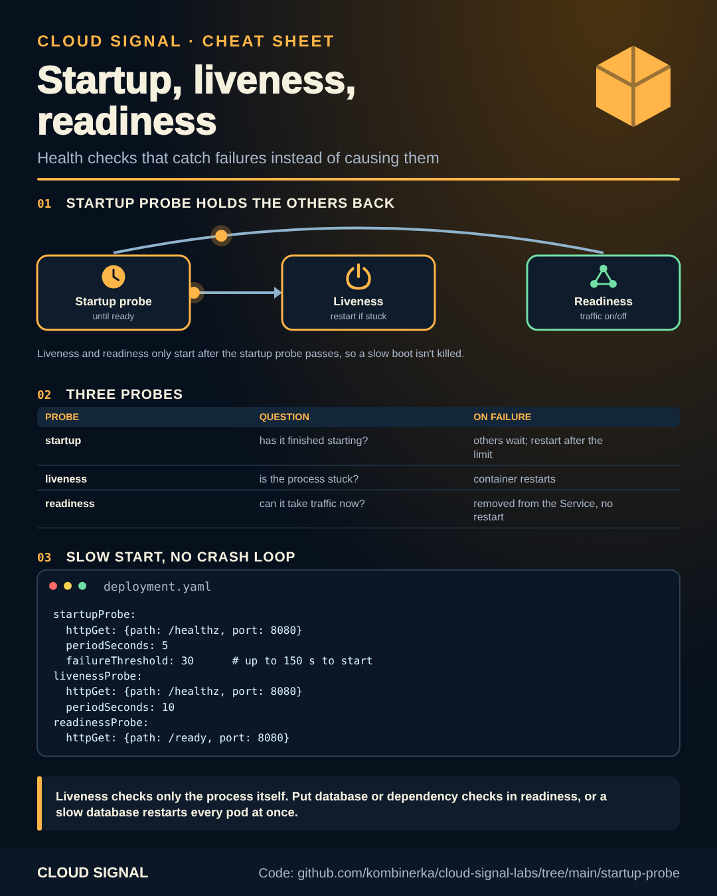

# Kubernetes keeps killing your slow app?

Companion code for the Cloud Signal Short **"Kubernetes Keeps Killing Your Slow App? Check the Liveness Probe"**



<sub>Static version for printing or sharing: [cheatsheet.png](cheatsheet.png)</sub>

If the app needs 90 seconds to start and the liveness probe starts checking after 10, the probe fails while the app
is still loading, Kubernetes restarts it, and the restart is just as slow: a crash loop caused by the health check.

| Probe | Question | On failure |
|---|---|---|
| `startupProbe` | has it finished starting? | holds the others back; restarts after `failureThreshold × periodSeconds` |
| `livenessProbe` | is the process stuck? | restarts the container |
| `readinessProbe` | can it take traffic now? | removed from the Service, **no** restart |

[`deployment.yaml`](deployment.yaml) gives the app up to 150 s to start, keeps liveness to the process itself and
puts dependency checks in readiness.

```bash
kubectl apply -f deployment.yaml
kubectl get pods -w                         # RESTARTS stays 0 while it starts
kubectl describe pod <pod> | sed -n '/Events/,$p'   # "Startup probe failed" while loading is expected
```

A probe should catch failures, not cause them.

## Sources

- Kubernetes: Configure Liveness, Readiness and Startup Probes: https://kubernetes.io/docs/tasks/configure-pod-container/configure-liveness-readiness-startup-probes/
