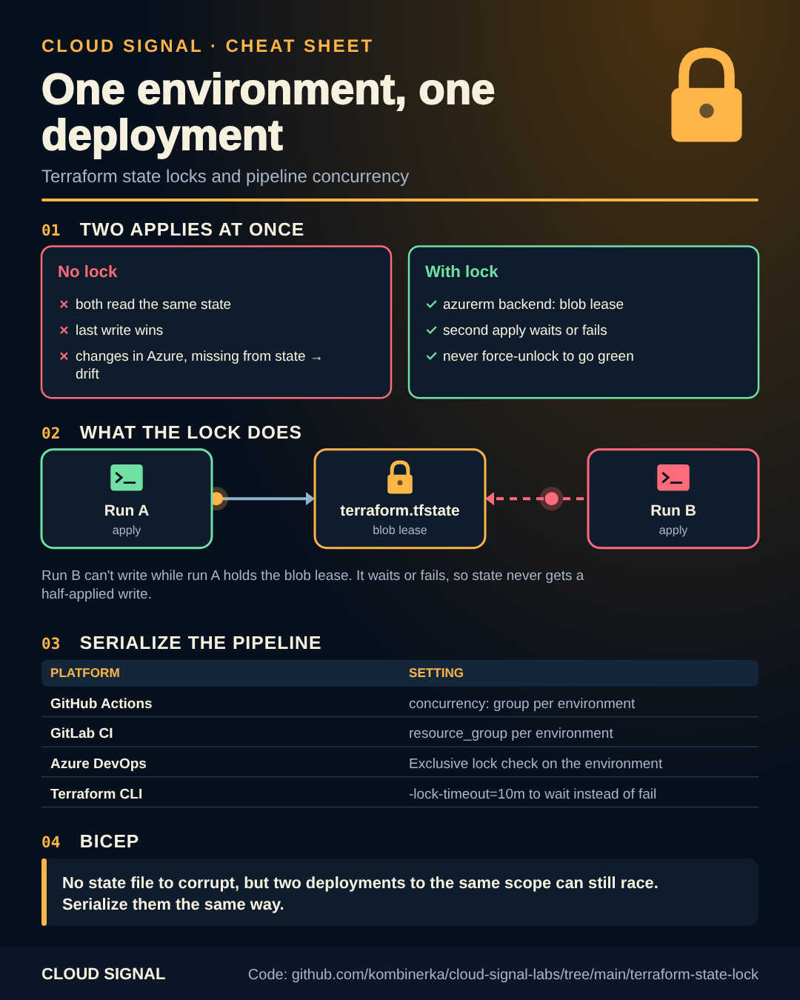

# Two applies at once: who wins?

Companion code for the Cloud Signal Short **"Two Pipelines Run terraform apply at Once. Who Wins?"**

Static version for printing or sharing: [cheatsheet.png](cheatsheet.png)

Without a lock, both runs read the same state, both change things, and the last one to write the state wins. The
other run's changes still exist in Azure but not in the state: drift and duplicate resources.

**1. Lock the state (Terraform)**: the `azurerm` backend locks with a blob lease; [`terraform/backend.tf`](terraform/backend.tf).
Use `-lock-timeout=10m` so a second run waits instead of failing. Don't `terraform force-unlock` unless you're sure
the other run is dead.

**2. Serialize the pipeline** (Terraform and Bicep alike):

| Platform | Setting | File |
|---|---|---|
| GitHub Actions | `concurrency: group` per environment, `cancel-in-progress: false` | [`github/.github/workflows/deploy.yml`](github/.github/workflows/deploy.yml) |
| GitLab CI | `resource_group` per environment | [`gitlab/.gitlab-ci.yml`](gitlab/.gitlab-ci.yml) |
| Azure DevOps | Exclusive lock check on the environment + `lockBehavior: sequential` | [`azure-devops/azure-pipelines.yml`](azure-devops/azure-pipelines.yml) |

**Bicep** has no state file to corrupt: Azure is the record. But two deployments to the same scope can still
overwrite each other's settings, so serialize them the same way (and see deployment stacks in
[azure-takeover](../azure-takeover/05-deployment-stacks/)).

## Sources

- Terraform: State locking: https://developer.hashicorp.com/terraform/language/state/locking
- Terraform: azurerm backend: https://developer.hashicorp.com/terraform/language/backend/azurerm
- GitHub: Control the concurrency of workflows and jobs: https://docs.github.com/en/actions/how-tos/write-workflows/choose-when-workflows-run/control-workflow-concurrency
- GitLab: Resource group: https://docs.gitlab.com/ci/resource_groups/
- Azure DevOps: Exclusive lock check: https://learn.microsoft.com/en-us/azure/devops/pipelines/process/approvals#exclusive-lock
